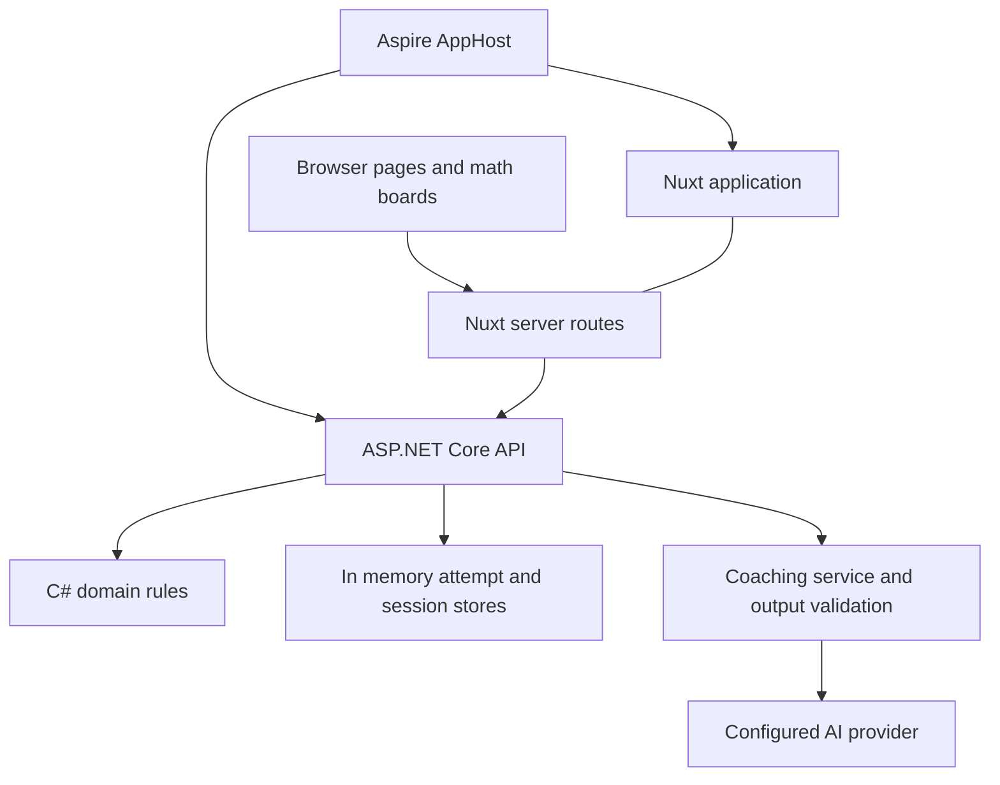

# TsiaCoach Code Structure and Patterns

Updated October 21, 2026.

TsiaCoach combines math practice, guided coaching, and interactive manipulatives. Its central architectural rule is that the server determines answer correctness and scaffold progress, while the browser manages presentation and hands-on interaction. Authored practice items and coaching policies constrain the choices available to the AI coach.

This guide explains the current C# and Nuxt implementation, the patterns that repeat across it, and where to make common changes.

## Application structure



| Location | Responsibility |
| --- | --- |
| `TsiaCoach.AppHost` | Declares the API and Nuxt processes, their configuration, and startup dependency. |
| `TsiaCoach.Domain` | Defines practice items, mathematics, semantics, attempts, coaching policies, scaffolds, and evaluation rules. |
| `TsiaCoach.WebApi` | Exposes HTTP endpoints, coordinates domain operations, stores runtime state, and calls AI providers. |
| `TsiaCoach.Common` | Contains shared infrastructure such as `UnionAttribute`. |
| `TsiaCoach.ServiceDefaults` | Supplies shared service infrastructure for health and observability. |
| `tsia-coach-web-nuxt/app` | Contains Vue pages, components, composables, and browser interactions. |
| `tsia-coach-web-nuxt/server` | Implements Nuxt server routes, API forwarding, and transport validation. |
| `tsia-coach-web-nuxt/shared` | Provides contracts and type helpers shared by Nuxt code. |
| `TsiaCoach.WebApi.Tests` | Tests domain behavior and API contracts, alongside coaching and provider behavior. |
| `TsiaCoach.AppHost.Tests` | Tests the distributed application through Aspire. |

The active AppHost wires the Nuxt application and API. `TsiaCoach.Web.Next` exists in the checkout but is not part of that AppHost wiring or the listed solution projects.

The repository pins a .NET 11 preview SDK in `global.json`; the domain project targets `net11.0` and enables preview C# syntax. The frontend package specifies Node 22, pnpm, Nuxt 4, and Vue 3. These are repository configuration choices, rather than general prerequisites for all applications using these patterns.

## Domain objects express learning rules

The domain models more than a question string and its answer. A `PracticeItem` brings together text structure, semantic meaning, mathematical objects, answer choices, answer bindings, a correct answer ID, and the misconception associated with each distractor.

This lets different parts of the application refer to the same underlying meaning. A phrase can be highlighted in the question, associated with a mathematical object, and used as a focus for coaching.

Three patterns recur here:

1. **Typed identifiers.** Small types such as `AnswerChoiceId` and `AttemptId` distinguish references that would otherwise all be strings. This makes accidental substitution harder in C#.
2. **Validated construction.** Factories such as `PracticeItem.Create` and `Scaffold.Create` run their validators before returning an object. Follow those factories when authoring new content; their validation is not automatically applied to every possible direct record construction.
3. **Explicit alternatives.** Union types describe outcomes and states, including correct versus incorrect answers and active versus completed scaffold sessions. Callers inspect the alternative and handle its associated data.

For example, `PracticeItem.Evaluate(answerChoiceId)` first rejects an answer that does not belong to the item. It then returns either `CorrectCheck` or `IncorrectCheck`, with the authored misconception attached to the latter. Answer evaluation is deterministic and does not need an AI call.

Source: [PracticeItem.cs](C:/Users/amado/code/TsiaCoach/TsiaCoach.Domain/PracticeItems/PracticeItem.cs).

## History produces current state

An `Attempt` stores its item identity and the history of checks. Each check records the selected answer and server time. `Attempt.Phase(practiceItem)` derives the coaching phase from that history:

| History | Derived phase |
| --- | --- |
| No checks | `BeforeCheck` |
| Latest answer is incorrect | `AfterIncorrectCheck` |
| Latest answer is correct | `AfterCorrectCheck` |

`Append` returns a new attempt with an additional check. It rejects mismatched practice items, duplicate check IDs, timestamps that move backward, and further checks after a correct answer.

Scaffold sessions use a related pattern. Their progress is derived by replaying submitted evidence through `ScaffoldStepEvaluator`. A session is pinned to its attempt, scaffold, and authorized entry step. Successful submissions advance the path; supported grid interactions can also accept a legal partial move while keeping the current step open. The API exposes `complete`, `accepted`, and `rejected` outcomes.

This resembles event sourcing in its use of recorded facts to derive state, but the current implementation uses ordinary in-memory stores. It does not provide durable event storage. Restarting the API loses the attempts and sessions held by those stores.

Sources: [Attempt.cs](C:/Users/amado/code/TsiaCoach/TsiaCoach.Domain/Attempts/Attempt.cs), [ScaffoldSession.cs](C:/Users/amado/code/TsiaCoach/TsiaCoach.Domain/ScaffoldSessions/ScaffoldSession.cs), and [InMemoryAttemptStore.cs](C:/Users/amado/code/TsiaCoach/TsiaCoach.WebApi/Attempts/InMemoryAttemptStore.cs).

## Endpoints translate between HTTP and application behavior

`Program.cs` is the composition root: it registers services and stores, configures JSON and telemetry, and maps endpoint groups. Files under `EndPoints` group routes by feature, such as attempts, coaching, and scaffold sessions.

The usual request flow is:

1. Validate the incoming request.
2. Resolve the relevant item or runtime state.
3. Call a store, domain operation, or coordinating service.
4. Map the result into a response contract and HTTP status.

`AttemptEndpoints` demonstrates this with typed HTTP results. An unknown attempt becomes a 404, an unrelated answer becomes a 400, and a check after completion becomes a 409. The endpoint translates these outcomes; the domain and store implement the underlying rules.

Response mappers build projections for clients. This is particularly important on student routes: the browser needs the prompt and permitted actions, while answer keys and evaluator inputs belong on the server. Keep the learner-facing response separate from the full authored model when adding fields.

Sources: [Program.cs](C:/Users/amado/code/TsiaCoach/TsiaCoach.WebApi/Program.cs) and [AttemptEndpoints.cs](C:/Users/amado/code/TsiaCoach/TsiaCoach.WebApi/EndPoints/AttemptEndpoints.cs).

## Nuxt provides a backend for the browser

Browser code generally calls relative `/api/...` routes. Nuxt receives those requests and forwards them to the C# API using its private `runtimeConfig.apiUrl`. Aspire supplies that address through `NUXT_API_URL`.

This pattern is often called a backend for frontend, or BFF. It gives browser code one application origin and puts backend address resolution and forwarding on the Nuxt server.

The route files are usually small. For example, `server/api/attempts.post.ts` reads and checks the request body, then delegates to `server/utils/attempts.ts`. That utility resolves configuration, forwards the request, and preserves backend problem responses. A connection failure becomes a 502.

Types in `server/types/schema.d.ts` describe the OpenAPI contract. Files in `shared/types` give those contracts shorter names and add helpers. Some frontend types, including scaffold submission alternatives, are also declared manually, so backend changes still require checking the corresponding TypeScript definitions.

Sources: [attempts.post.ts](C:/Users/amado/code/TsiaCoach/tsia-coach-web-nuxt/server/api/attempts.post.ts), [attempts.ts](C:/Users/amado/code/TsiaCoach/tsia-coach-web-nuxt/server/utils/attempts.ts), and [scaffolds.ts](C:/Users/amado/code/TsiaCoach/tsia-coach-web-nuxt/shared/types/scaffolds.ts).

## Frontend state and interaction have separate owners

The frontend uses Pinia stores for feature workflows and Vue composables for reusable behavior. The scaffold session store owns loading, submission, coaching requests, errors, and the latest server projection. It updates progress from the server response.

Interactive boards use a more local division:

| Layer | Example | Role |
| --- | --- | --- |
| Playground composition | `MathTablaPlayground.vue` | Assembles board geometry, scene policy, interaction controls, and authoring tools. |
| Scene state | `useRodScene.ts` | Owns trains and selection, validates candidate changes, and applies scene operations. |
| Interaction | `useRodPlaygroundInteraction.ts` | Connects user interaction to scene behavior. |
| Pure calculation | `mathtabla.geometry.ts`, `area-grouping.ts` | Computes geometry and mathematical arrangements independently of rendering. |
| Rendering | `MathTablaBoard.vue`, `SceneRodLayer.vue` | Displays the board and scene pieces. |

A scene policy supplies constraints such as board dimensions, allowed regions, and whether editing is available. Passing those constraints into a composable allows related boards to reuse behavior with different rules.

File loading follows the same boundary discipline. `validateLevelDocument` checks the document schema, board compatibility, duplicate IDs, every step snapshot, and goals before returning data for use. Imported scenes pass through validation rather than becoming trusted scene state immediately.

Sources: [scaffold-session.ts](C:/Users/amado/code/TsiaCoach/tsia-coach-web-nuxt/app/pages/scaffolds/scaffold-session.ts), [useRodScene.ts](C:/Users/amado/code/TsiaCoach/tsia-coach-web-nuxt/app/composables/useRodScene.ts), and [level-document.ts](C:/Users/amado/code/TsiaCoach/tsia-coach-web-nuxt/app/components/playground/files/level-document.ts).

## AI coaching operates within authored choices

`CoachingTurnService` checks that a request is valid for the attempt's current phase before it invokes the model. Requesting help before a check serves an authored probe directly, without a model call.

For a probe answer, the model selects an authorized shape. The validator resolves that choice to an authored message and scaffold entry. Questions about a scaffold step similarly resolve to an authored reply and do not move the student. Other supported coaching moves can contain generated text, which is checked against the move contract and authorized references.

The overall sequence is:

```text
Request and attempt phase
  -> legal event check
  -> coaching definition with authorized choices
  -> model runner
  -> output validator
  -> response and recorded coaching move
```

Provider errors and invalid model output become explicit service outcomes. Provider registration supports Foundry and OpenRouter through configuration; `ICoachingAgentRunner` gives the coordinating service a replaceable boundary for model execution.

When extending coaching, update the authored policy, definition, validator, response handling, and tests together. A prompt instruction alone does not implement a new permitted behavior.

Sources: [CoachingTurnService.cs](C:/Users/amado/code/TsiaCoach/TsiaCoach.WebApi/CoachingAgents/CoachingTurnService.cs) and [CoachTurnValidator.cs](C:/Users/amado/code/TsiaCoach/TsiaCoach.WebApi/CoachingAgents/CoachTurnValidator.cs).

## Example of checking an answer

1. The student selects an answer on the sample item page.
2. Frontend code submits the answer ID to the Nuxt attempt-check route.
3. The Nuxt utility forwards the request to the C# API.
4. The API resolves the attempt and practice item.
5. The store calls `Attempt.Append`, which enforces the attempt rules and evaluates answer membership.
6. The store saves the replacement attempt in memory.
7. The response mapper derives the updated phase and returns its projection.
8. The frontend renders feedback from that projection.

An incorrect answer can then lead to a separate diagnosis request. Coaching and answer checking are separate operations, so model availability is not required to decide whether the selected answer is correct.

## Testing follows the architectural boundaries

Domain and API tests cover evaluation, state transitions, session authorization, coaching validation, and endpoint responses. API tests use TUnit infrastructure; the repository selects Microsoft Testing Platform in `global.json`.

Frontend tests are commonly colocated with the code they cover. Vitest runs unit and component tests, a separate integration configuration covers manipulative contract tests, and Playwright covers browser flows under `tests/e2e`.

The frontend scripts encode an important dependency: `dev`, `build`, and `generate` run `test:sync` first. That command runs both unit and contract suites. Starting frontend development therefore also runs tests, and contract-test setup can affect startup.

## Where to make common changes

| Change | Starting point | Related checks |
| --- | --- | --- |
| Add a practice item | Domain sample authoring and `SamplePracticeCatalog` | Item validation, answer evaluation, learner prompt response. |
| Change answer rules | `PracticeItem.Evaluate` and attempt behavior | Domain and attempt endpoint tests. |
| Add a scaffold interaction | Domain actions, submissions, evaluator, and response mapping | Shared frontend types, scene rendering, session tests, browser flow. |
| Add coaching behavior | Coaching policy, definition factory, and validator | Legal phases, authorized references, runner and endpoint tests. |
| Change rod operations | Scene composables and pure placement or geometry helpers | Scene tests and relevant board browser tests. |
| Change level files | File schema, document validator, and authoring composables | Invalid imports, snapshot validation, save and load tests. |
| Add durable persistence | Attempt and scaffold session stores and service registration | Atomic updates, concurrency, history preservation, restart behavior. |

For a first reading, follow `AppHost.cs`, `Program.cs`, `PracticeItem.cs`, `Attempt.cs`, and `AttemptEndpoints.cs`, then trace the Nuxt forwarding utility and feature store. For board work, start with `MathTablaPlayground.vue` and follow its composable imports.

Related repository documents: [Student Coaching Diagnostics](C:/Users/amado/code/TsiaCoach/docs/architecture/student-coaching-diagnostics.md), [Parity Ladder Path](C:/Users/amado/code/TsiaCoach/docs/scaffolds/parity-ladder-path.md), and [Coach Playground](C:/Users/amado/code/TsiaCoach/docs/coach-playground.md).
