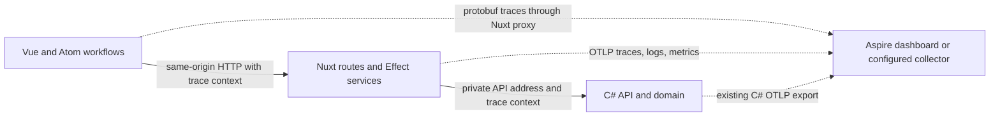

# Effect services, Atom state, and telemetry

Updated November 19, 2026.
Status: implementation and operations guide.

TsiaCoach uses Effect 4 in the active Nuxt application's service and I/O boundaries. Effect Atom Vue owns the practice and scaffold workflow state. The C# API remains authoritative for answer correctness, attempts, coaching policy, and scaffold progression. Aspire continues to orchestrate the Nuxt and ASP.NET processes.

Read [Code structure and patterns](code-structure-and-patterns.md) for the domain and application overview. The inactive Next application is outside this migration.

## Runtime boundaries



Paths in the following table are relative to `tsia-coach-web-nuxt/`.

| Owner | Responsibility |
| --- | --- |
| `shared/effect` | Effect Schema adapters, W3C trace-context utilities, OTLP configuration, error unwrapping, and telemetry privacy policy. |
| `server/effect` | Request-scoped backend service factories, typed transport errors, the H3 execution adapter, telemetry providers, and browser trace proxy policy. |
| `app/effect` | Per-app Atom registry, feature workflow transport, browser I/O services, scoped resource cleanup, and the stateless Effect execution runtime. |
| `app/plugins/effect.ts` | Creates and injects the request/browser registry, restores payload state, dehydrates SSR state, and disposes app-owned resources. |
| `app/plugins/telemetry.client.ts` | Registers browser tracing before workflows execute and exports through the same-origin proxy when enabled. |
| `server/plugins/effect.ts` | Initializes the server telemetry owner and closes it with Nitro. |

The process-level Effect runtime holds stateless tracing services. Learner state, in-flight workflow bookkeeping, and request-specific fetch configuration belong to a Nuxt app/request context. Do not place these values in module-global caches or in the telemetry singleton.

## Services and HTTP behavior

Browser workflows call relative `/api/...` routes through the Effect transport. During SSR, the injected fetch adapter comes from `useRequestFetch()`, keeping it attached to that request. Nuxt resolves the backend from private `runtimeConfig.apiUrl`; Aspire supplies `NUXT_API_URL`.

H3 routes remain small HTTP adapters. Feature utilities construct request-scoped services with `backendApiFor(event)` and return Effects to `runServerEffect`. The execution adapter establishes a request span, preserves typed failures, maps disconnects to cancellation, records request metrics, and removes its listeners after completion.

The backend transport owns outbound spans and retries. Its underlying ofetch retry is disabled. Backend GET requests receive at most one retry on transient transport/HTTP failures. Mutation and paid AI POSTs are not automatically retried. Existing timeouts remain in force, including the decision route's 35-second timeout.

Keep these contracts when extending a feature:

- Forward only authorized request fields. Student requests do not send correctness claims or solution-bearing evaluator data.
- Preserve existing status codes and ProblemDetails behavior. Coaching responses continue to sanitize provider failures.
- Keep the last successful server projection on a failed check. The browser does not calculate replacement correctness or advance a scaffold locally.
- Do not expose Effect causes or fiber internals as HTTP response bodies. The boundary unwraps typed errors before the established error mapper handles them.

Application-owned runtime schemas use Effect Schema. The compatibility adapter exposes `parse`, `safeParse`, and mutable decoded DTOs to existing synchronous scene code. Strict schemas retain excess-property rejection and authored refinements. Nuxt Content retains its framework-required Zod schemas. Generated OpenAPI types remain the reference for C# response contracts.

## Atom state, SSR, and hydration

There are two workflow features: practice items and scaffold sessions. Their exported composable names still include `Store` for caller compatibility; Pinia is no longer a runtime dependency. Component-local board, selection, rendering, and geometry state remains in Vue composables.

Each SSR Nuxt app receives a fresh `AtomRegistry`; the browser receives one registry for its application lifetime. The plugin provides both the official Atom Vue `registryKey` and the workflow context. Never use Atom Vue's module-global default registry during SSR.

Workflow fields explicitly declared with `workflowField` are retained, serializable writable Atoms. Nested Vue-facing DTO edits publish a replacement root to Atom subscribers. Components consume official `useAtomValue` bindings on the client; imperative callers, including `window.__TSIA_COACH__`, use the same feature instance and registry.

SSR requires a different read adapter: `workflowToRefs` returns live registry-backed facade refs on the server. Atom Vue's subscription uses `watchEffect`, which Vue stops during SSR setup. A subscription created before an awaited `callOnce` can otherwise retain the initial empty value even though the SSR payload contains loaded state, producing hydration mismatches. Client components continue using the official Atom Vue binding.

The initialization sequence is:

1. Create the app/request registry and restore any payload entries before components or the agent bridge read state.
2. Invoke the existing keyed `callOnce` initializer explicitly. Practice and scaffold initialization can create attempts/sessions during SSR; creating or subscribing to an Atom never triggers those POSTs.
3. Await initialization, then render the settled state through the SSR adapter.
4. Dehydrate declared fields into `payload.state['effect-workflows']` at `app:rendered`, then dispose the SSR context. Error and app-unmount paths also dispose it.
5. Hydrate the browser registry before initial reads. Loaded markers and server-issued IDs prevent duplicate initialization requests.

Serialization uses `Schema.Unknown` for the explicitly declared field values and transfers plain JSON. This is an allowlist of state fields, not a new runtime validator or automatic redactor. Add only learner-safe DTO/state fields; exclude promises, fibers, runtimes, exporters, credentials, browser resources, and trace context. Validate external data with the feature's actual schema before assigning it.

Per-app feature retention preserves attempt history during navigation. In-flight attempt/coaching operations are deduplicated; checks retain the last server projection on failure. Scaffold loads use a generation guard, so an older route response cannot overwrite the current route. Late coaching replies cannot overwrite a subsequently advanced step.

## Browser I/O and resource scopes

`BrowserIO` is an Effect service for file reads, storage, clipboard access, and downloads. `BrowserIOError` identifies the failed operation. Storage remains best effort: denied storage does not make a playground unusable. Imported data still passes through schema and scene validation; older file reads cannot replace a newer selection, and confirmed scene replacement remains atomic.

`createResourceScope` owns acquired listeners, timers, observers, animation resources, and object URLs. Register release actions when acquiring a resource, then close the scope from the component's teardown hook. Synchronous scope closure preserves cleanup ordering before DOM removal. Timer slots replace their previous timer rather than accumulating finalizers.

Vue still renders the boards and GSAP still animates them. Pure mathematical operations and seeded generation remain deterministic functions. Keep each mounted playground's scene state separate. Instrument useful operations rather than individual pointer movements or animation frames.

## Telemetry and Aspire

The Nuxt server owns one tracer provider, one logger provider, and one meter provider. Effect's `OtelTracer.layerGlobal` and logger bridge connect to those providers. Business metrics use the `TelemetryMetrics` Effect service backed by the same meter provider; there is no second Effect metric registry exporter.

The browser realm retains one provider and page-hide listener across HMR. Reload cleanup flushes that provider and disposes the app Effect runtime without re-registering global telemetry. Nitro startup awaits the previous provider owner's shutdown, and SSR Effect executions resolve the current global tracer for each run. This prevents a renderer reload from retaining a closed provider. Reload the browser page after changing its telemetry configuration.

Instrumentation is explicit at the H3 adapter and central outbound transports. W3C `traceparent` and `tracestate` cross the boundaries; baggage is not forwarded. A checked answer can therefore connect the browser workflow/client span, Nuxt request, Effect operation, backend client span, and ASP.NET request in one trace. Existing C# instrumentation continues to cover its downstream operations.

The AppHost applies `.WithOtlpExporter(OtlpProtocol.HttpProtobuf)` to `web-nuxt` and enables the dashboard HTTP ingestion listener. The C# resource retains its existing gRPC export. Aspire injects the Nuxt exporter address, protocol, private authentication headers, service identity, and development certificate trust. Application code consumes those values rather than reconstructing dashboard ports.

Browser trace export is controlled by public `telemetryEnabled`, configured with `NUXT_PUBLIC_TELEMETRY_ENABLED`. The AppHost enables it for local development. The only browser destination is `POST /api/telemetry/traces` on the application's own origin. When `telemetryEnabled` is false, that proxy accepts and discards requests (204) even if a server collector is configured. When enabled, it accepts protobuf traces for its fixed configured upstream, injects collector authentication server-side, and does not expose collector response bodies or headers. It is excluded from request tracing to avoid tracing its own exporter traffic.

Browser root spans use a parent-based sampler with public `telemetrySamplingRatio`. It defaults to `1` (all traces) and accepts a finite value from `0` through `1`; empty or invalid input falls back to `1`. Existing parent sampling decisions are preserved. For production server-origin traces, use the standard Node SDK `OTEL_TRACES_SAMPLER=parentbased_traceidratio` and set `OTEL_TRACES_SAMPLER_ARG` to the same ratio. Requests carrying a browser parent retain that parent's sampling decision.

Private endpoints and OTLP authentication headers must never enter `runtimeConfig.public`, Atom payloads, browser bundles, or browser exporter configuration. Preserve Aspire's Node certificate trust. Do not disable TLS verification to make an exporter connect.

Export privacy filtering retains operation metadata and trace relationships while removing request/provider content. Server logs export safe event categories. Metric labels use normalized operation/outcome values, not attempt IDs, answers, prompts, or student content.

### Production configuration

Published workloads need explicit environment configuration; Aspire's local telemetry injection is not production provisioning. Production Nitro must run as a Node server, with `.output/server/index.mjs` as its entry point.

| Variable | Purpose |
| --- | --- |
| `NUXT_API_URL` | Private reachable C# API base address. |
| `OTEL_EXPORTER_OTLP_ENDPOINT` | HTTP collector base address; `/v1/traces`, `/v1/logs`, and `/v1/metrics` are appended. |
| `OTEL_EXPORTER_OTLP_PROTOCOL` | Set `http/protobuf` for this Nuxt exporter implementation. A gRPC URL cannot be reused as an HTTP exporter URL. |
| `OTEL_EXPORTER_OTLP_HEADERS` | Server-only comma-separated authentication headers, supplied by the deployment secret mechanism. |
| `OTEL_SERVICE_NAME` | Nuxt service identity. Defaults to `web-nuxt`. |
| `OTEL_RESOURCE_ATTRIBUTES` | Comma-separated service/resource metadata, excluding student content. |
| `NUXT_PUBLIC_TELEMETRY_ENABLED` | Set `true` to enable browser trace export through the proxy; otherwise it remains disabled. This boolean is public. |
| `NUXT_PUBLIC_TELEMETRY_SAMPLING_RATIO` | Browser root sampling probability from `0` to `1`; defaults to `1`. Invalid or empty input also uses `1`. |
| `OTEL_TRACES_SAMPLER`, `OTEL_TRACES_SAMPLER_ARG` | Standard Node SDK server sampling configuration. Use `parentbased_traceidratio` and the matching browser ratio for aligned root sampling. |

Signal-specific `OTEL_EXPORTER_OTLP_TRACES_*`, `LOGS_*`, and `METRICS_*` endpoint/protocol/header settings override their common counterpart. A signal-specific endpoint is a complete signal URL and is used verbatim. Setting `OTEL_TRACES_EXPORTER`, `OTEL_LOGS_EXPORTER`, or `OTEL_METRICS_EXPORTER` to `none` disables that export.

Without a valid configured endpoint, remote export is disabled and workflows still run. Browser export remains opt-in. No Azure Monitor resource or production deployment is provisioned by this migration.

Use the tested Node 22.22.0 runtime from `.nvmrc` and `pnpm-workspace.yaml`; `package.json` requires Node 22.19+ within the 22.x line. Effect packages are pinned together at 4.1.4 because the Atom Vue APIs are unstable. Vitest remains on version 4; tests execute Effects directly rather than installing the Vitest-5-only Effect test integration.

## Verification commands

Run these from the repository root in PowerShell. Keep the AppHost path explicit, particularly when other Aspire applications are running:

```powershell
$effectAppHost = (Resolve-Path .\TsiaCoach.AppHost\TsiaCoach.AppHost.csproj).Path
aspire start --apphost $effectAppHost --non-interactive
aspire wait api --apphost $effectAppHost --non-interactive
aspire wait web-nuxt --apphost $effectAppHost --non-interactive
aspire describe --apphost $effectAppHost --format Json --non-interactive
```

Use the running resource names and endpoint URLs from `describe`; do not assume fixed API/frontend ports. In `tsia-coach-web-nuxt/`, set `NUXT_API_URL` to the discovered API HTTP address for contract checks and `PLAYWRIGHT_BASE_URL` to the discovered Nuxt address for the real-service smoke:

```powershell
pnpm exec node --version
pnpm test
pnpm exec vue-tsc --noEmit
pnpm lint
$env:NUXT_API_URL = '<discovered-api-http-url>'
pnpm exec vitest run --config vitest.integration.config.ts
$env:PLAYWRIGHT_BASE_URL = '<discovered-nuxt-url>'
pnpm exec playwright test --config playwright.aspire.config.ts
pnpm build
```

The Aspire Playwright configuration starts no servers, uses the repo-installed runtime, and writes artifacts under the repository's `output/effect-aspire/` directory. Its deterministic answer check uses the real C# API without a paid AI call. It verifies settled SSR hydration, no duplicate attempt POST, a browser request carrying W3C context, authoritative backend readback, and an actual browser protobuf trace batch accepted by the proxy. The captured `trace.json` contains the trace ID for dashboard/CLI inspection.

Inspect the same trace ID in Aspire and verify parent relationships across browser and server spans, a correlated Nuxt log, and the `tsia.web.requests`, `tsia.web.request.duration`, and `tsia.web.failures` metric instruments. Unit tests separately cover registry isolation, SSR/client rendering, hydration retention, cancellation, stale responses, safe HTTP errors, schema parity, I/O cleanup, and proxy/privacy policy.

`dev`, `build`, and `generate` run `test:sync`, which includes live contract tests. Their backend must be available. After a successful build, verify production startup with the configured environment using `pnpm exec node .output/server/index.mjs`. Starting the production artifact is a local smoke check and does not deploy the application.
